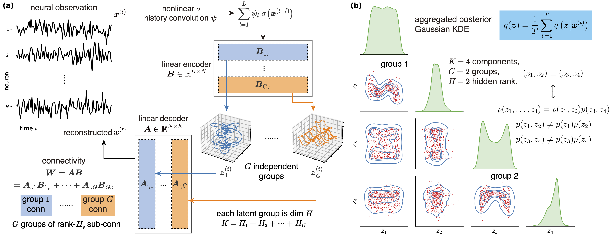

# A Factorized Low-Rank RNN Framework for Uncovering Independent Neural Latent Dynamics and Connectivity [ICML 2026 Spotlight]

<div align="center">Chengrui Li, Yunmiao Wang, Yule Wang, Weihan Li, Dieter Jaeger and Anqi Wu</div>

[[paper]](https://openreview.net/pdf?id=QvIbmX9jBr) [[arXiv]](https://arxiv.org/abs/2511.13899) [[slides]]() [[video]]() [[poster]]() [[文章]]()



## Overview

Low-rank recurrent neural networks (lrRNNs) uncover low-dimensional latent dynamics from neural population activity, but their connectivity often lacks independence interpretations. This repository implements **FacRNN** (Factored Recurrent Neural Network), a generative lrRNN / VAE framework that encourages **group-wise independence** among latent dynamics while allowing flexible within-group entanglement via a partial correlation penalty.

Experiments cover synthetic RNNs with input, monkey M1 reaching data, and mouse voltage imaging visualizations.

## Repository Structure

```text
facrnn/
├── disentangle.py              # KL, aggregated posterior, partial correlation, latent alignment
├── synthetic_rnn_input/        # Synthetic lrRNN with external input (paper baselines)
│   ├── main.py                 # Train / evaluate
│   ├── utils.py                # Encoder, decoder, VAE, Lightning module
│   ├── benchmark.ipynb         # Result visualization
│   └── data/
│       ├── data.pkl
│       └── data_generator.ipynb
├── monkey_nonlinear/           # Monkey M1 nonlinear encoder/decoder experiments
│   ├── conv.py                 # Main training script
│   ├── rotation_alignment.py   # Rotation / LINT alignment variants
│   ├── utils.py
│   ├── conv.ipynb
│   └── data/
└── voltage_temporal/           # Mouse voltage imaging visualization videos
    ├── voltage.mp4
    └── voltage_proposal.mp4
```

## Requirements

Python environment with GPU recommended. Main dependencies used by the scripts:

- `torch`, `lightning`, `torcheval`, `torchmetrics`
- `numpy`, `scipy`, `pandas`, `scikit-learn`
- `wandb` (experiment logging)
- `pdisvae` (used by the monkey experiment evaluation utilities)

Install the packages available from PyPI, for example:

```bash
pip install torch lightning torcheval torchmetrics numpy scipy pandas scikit-learn wandb
```

## Reproduce Paper Results

### 1. Synthetic RNN with input

```bash
cd facrnn/synthetic_rnn_input
python main.py --idx [idx] --mode both
```

- `idx` ranges from `0` to `59`
- Methods: `lrRNN`, `lrRNN+ICA`, `LINT`, `bdRNN`, `DisRNN-full`, `DisRNN`
- Seeds: `0`–`9`

`idx` is mapped to `(method, seed)` by

```python
method_list = [
    "lrRNN",
    "lrRNN+ICA",
    "LINT",
    "bdRNN",
    "DisRNN-full",
    "DisRNN",
]
seed_list = np.arange(10)

arg_index = np.unravel_index(args.idx, (len(method_list), len(seed_list)))
method, seed = method_list[arg_index[0]], seed_list[arg_index[1]]
```

Outputs are written under `results_baseline/`:

- `{method}_{seed}.ckpt` — model checkpoint
- `{method}_{seed}.csv` — quantitative metrics
- `{method}_{seed}_A.pt`, `{method}_{seed}_B.pt` — learned factors
- `{method}_{seed}_group_aligned_z_pred_mean.pt` — aligned latents

Then open `benchmark.ipynb` to reproduce the synthetic-experiment figures.

### 2. Monkey M1 (nonlinear)

```bash
cd facrnn/monkey_nonlinear
python conv.py [idx]
```

- `idx` ranges from `0` to `29`
- Methods: factorizations `(1, 2)`, `(2, 1)`, `(1, 4)`, `(2, 2)`, `(4, 1)`, and `MLP`
- Seeds: `0`–`4`

Results are saved under `results_conv/` (checkpoints, CSVs, and aligned latents).

For rotation / LINT alignment variants:

```bash
python rotation_alignment.py [idx]
```

- `idx` ranges from `0` to `39`

Use `conv.ipynb` for visualization.

### 3. Mouse voltage imaging

See the videos in `facrnn/voltage_temporal/` for qualitative visualizations of the voltage-imaging results.

## Citation

If you find this repository useful, please cite:

```bibtex
@inproceedings{li2026facrnn,
  title     = {A Factorized Low-Rank {RNN} Framework for Uncovering Independent Neural Latent Dynamics and Connectivity},
  author    = {Li, Chengrui and Wang, Yunmiao and Wang, Yule and Li, Weihan and Jaeger, Dieter and Wu, Anqi},
  booktitle = {International Conference on Machine Learning (ICML)},
  year      = {2026},
  note      = {Spotlight}
}
```
